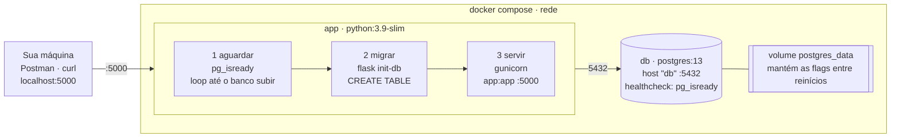
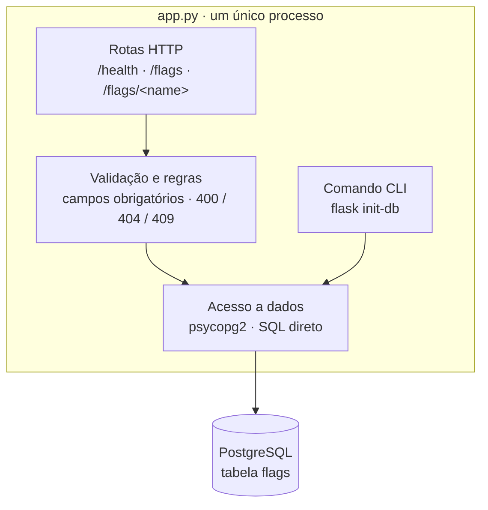
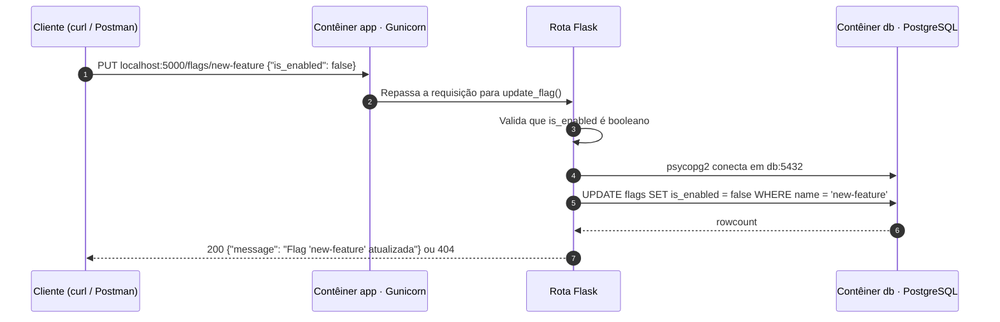
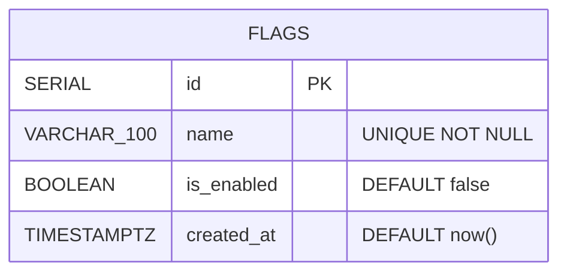

# ToggleMaster · Monolito local

> Tech Challenge · Fase 1 · Feature Flag as a Service

Uma API monolítica em Flask que cria, lista e ativa/desativa feature flags. Localmente ela roda com Docker Compose: um contêiner com a aplicação e outro com o PostgreSQL.

---

## Arquitetura local



| Serviço | Imagem                                  | Porta                         | Papel                           |
| :------ | :-------------------------------------- | :---------------------------- | :------------------------------ |
| `app`   | build do `Dockerfile` (python:3.9-slim) | `5000` exposta no host        | API Flask servida pelo Gunicorn |
| `db`    | `postgres:13`                           | `5432` apenas na rede interna | Armazena a tabela `flags`       |

O `app` só sobe depois que o `db` passa no healthcheck (`depends_on: condition: service_healthy`). A conexão usa as variáveis `DB_HOST=db`, `DB_PORT`, `DB_NAME`, `DB_USER` e `DB_PASSWORD`.

---

## Por dentro do monolito



Rotas, regras de negócio, acesso ao banco e migração vivem no mesmo arquivo e são implantados juntos como uma única unidade.

---

## Uma requisição, de ponta a ponta



---

## Modelo de dados



```sql
CREATE TABLE flags (
  id         SERIAL PRIMARY KEY,
  name       VARCHAR(100) UNIQUE NOT NULL,
  is_enabled BOOLEAN NOT NULL DEFAULT false,
  created_at TIMESTAMP WITH TIME ZONE DEFAULT CURRENT_TIMESTAMP
);
-- criada pelo comando `flask init-db`
```

---

## Endpoints da API

| Método | Caminho         | O que faz                                             | Respostas                     |
| :----- | :-------------- | :---------------------------------------------------- | :---------------------------- |
| `GET`  | `/health`       | Verificação de saúde, sem acessar o banco             | `200`                         |
| `POST` | `/flags`        | Cria uma flag a partir de `{"name", "is_enabled"}`    | `201` · `400` · `409` · `500` |
| `GET`  | `/flags`        | Lista todas as flags, ordenadas por nome              | `200` · `500`                 |
| `GET`  | `/flags/<name>` | Retorna o status de uma flag                          | `200` · `404` · `500`         |
| `PUT`  | `/flags/<name>` | Ativa ou desativa uma flag com `{"is_enabled": bool}` | `200` · `400` · `404` · `500` |

---

## Como rodar

```bash
docker compose up --build
curl http://localhost:5000/health   # {"status": "ok"}
docker compose down
```

---

## Monolito: vantagens e desvantagens

| Vantagens                              | Desvantagens                                    |
| :------------------------------------- | :---------------------------------------------- |
| Um único código e um único deploy      | Qualquer mudança exige reimplantar tudo         |
| Fácil de rodar localmente e de depurar | Escala apenas como um bloco inteiro             |
| Sem latência de rede entre módulos     | Uma falha pode derrubar a aplicação inteira     |
| Ideal para um MVP como o ToggleMaster  | Fica difícil de manter conforme o código cresce |
